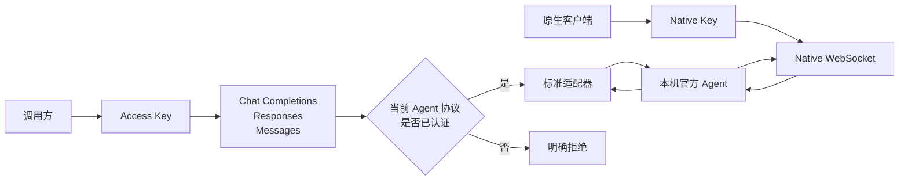
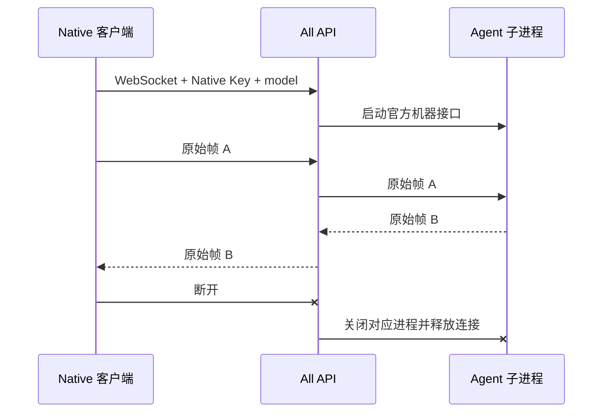

# All API v0.4 决策图

状态：已确认并作为实现与验收依据。配置版本为4，不迁移旧配置。

核心原则：

> All API 与 Agent 在同一台机器上。Native 只转发；标准接口只做经过验证的格式组装。配置、权限、工具执行和会话仍属于 Agent。

## 1. 产品边界

- All API 是本机 Agent 桥接器，不是模型平台、多机调度器或公共 relay。
- 支持本机、Cloudflare Named Tunnel、Tailscale Funnel、自有 SSH relay 和
  用户自行管理的直接网络入口。
- 公网入口不扩大权限：管理仍只走本机 Unix socket 或 Windows named pipe。
- workspace 是允许选择的初始工作目录，不是文件沙箱。真正隔离由 Agent
  官方权限、操作系统账户、容器或虚拟机负责。

## 2. 四种协议入口



- Chat Completions、Responses、Messages 使用各自官方请求、响应、流式事件和
  错误形状。
- Native WebSocket 不增加 All API 消息信封，输入输出帧保持不变。
- 不提供旧式文本 Completions。
- 新 Agent 或未知版本默认只有 Native；标准接口必须经过认证。

## 3. Key 与发现权限

| 能力 | Access Key | Native Key | 本机管理 |
|---|---:|---:|---:|
| 查询可见模型、工作区和能力 | 授权范围 | 全部 | 全部 |
| Chat / Responses / Messages | 是 | 否 | 否 |
| 文件接口 | 是 | 否 | 否 |
| Native WebSocket | 否 | 是 | 否 |
| 修改配置、Key、安装或更新 | 否 | 否 | 是 |

- Native Key 是高权限凭据，但不能管理本机或调用标准执行。
- Native Key 撤销后立即关闭该 Key 的现有 WebSocket。
- Access Key 只保存模型、工作区和默认工作区授权，不保存 Agent 参数。

## 4. 模型与配置

模型名是 Agent 配置单，例如 `codex:review`，不是单一大模型名称。

- `source=local`：直接使用当前本机 Agent 配置。
- `source=managed`：保存官方原生参数块，不创造统一 Agent 配置语言。
- Codex managed 结构为 `thread`、`turn` 和可选 Native `args`/`env`。
- Claude managed 结构为 SDK `options` 和可选 Native `args`/`env`。
- All API 不维护 Agent 字段白名单；原生参数不支持时由 Agent 明确报错。
- 未知的 All API 外层参数块直接拒绝，不能静默忽略。

Native 帧中的设置优先于模型配置能够提供的启动默认值；All API 不修改帧。
无法由 Agent 原生帧表达的启动参数仍来自模型配置。能力目录明确声明每种
Native 协议能否从帧中选择工作目录。

## 5. Native 传输与生命周期



- Native 只限制连接数、帧大小和待发送字节，不解析回合。
- Agent 启动期间到达的帧按序缓冲且受同一字节上限约束。
- 客户端断开、Key 撤销、帧超限和缓冲超限都会关闭 Agent 子进程。
- All API 不保存 Native 输出，不实现重放或自己的重连协议。
- Agent 已保存的 thread/session 仍可通过其原生 resume 能力续接。

## 6. 标准输入与 tools

- 多轮角色、内容块、工具定义、tool choice、工具调用和工具结果必须完整保留。
- 调用方 tools 只作为带明确标记的文字上下文交给 Agent。
- All API 不注册 Agent 原生工具、不暂停等待客户端工具结果、不解析 Agent
  文本猜测 tool call，也不构造 function-calling 循环。
- Chat Completions 和 Messages 忽略普通 Agent 过程事件，只返回回答和必要的
  交互文字。
- Responses 默认把无法结构化表达的 Agent 过程事件转成包含完整 JSON 的文字；
  `server.responsesIncludeProcessEvents: false` 可关闭这一行为。
- 能力目录分别声明 `agent_process_events` 为 `omitted`、`text` 或 `lossless`。
- 原生过程、真实工具控制和双向交互使用 Native。

## 7. 审批与交互

- Native 原样双向传输审批、用户提问和其他交互帧。
- 标准接口把完整交互请求转换为普通文字，然后结束当前 Agent 执行。
- All API 不自动批准，也不根据自然语言猜测决定。
- Chat 和 Messages 把该信息作为普通文本结束。
- Responses 返回文字，并将状态设为 `incomplete`，原因为
  `agent_interrupted`。
- 完全访问或其他非交互官方权限模式可以避免大部分命令/文件审批，但不保证
  Agent 永远不会提出其他交互。

## 8. 状态、失败和超时

- 只认 Agent 官方协议状态，不分析回答内容。
- “我无法完成”仍是正常文本；官方 failed/interrupted 或进程异常才是执行失败。
- JSON-RPC 有明确超时；进程退出会使 pending RPC 和事件队列立即失败。
- 标准并发达到上限时立即 busy，不由 All API 排队。
- Response 终态只能写入一次，迟到 completed 不得覆盖 cancelled/failed/incomplete。
- 原始 stderr 只留在本机调试信息中，远程错误不泄露路径和环境。

## 9. Responses 存储

Agent 线程仍是对话事实来源。All API 只为实现 Responses 官方状态查询保存：

- Response ID、model、workspace；
- 最终标准 output；
- 官方 usage；
- Agent thread/session 映射；
- completed、failed、cancelled 或 incomplete 状态。

不保存请求输入、原始 Agent 帧或完整会话副本。启用 Responses 过程事件时，
其文字投影是最终标准 output 的一部分，也会随 Response 保存。默认保留30天，
由 `server.responseRetentionDays` 配置。`store:false` 不落盘，也不能随后查询
或作为 `previous_response_id`。只有 completed 且有 Agent session 的 Response
可以续接。

过期记录由运行中的服务主动删除，不依赖重启或客户端再次查询。

服务重启时仍为 in_progress 的记录改为 `incomplete/server_restarted`，不自动
重跑。

## 10. usage

- 只使用 Agent 官方 usage，不估算、不重新分词、不填零。
- 目标协议允许省略时才能省略。
- 目标协议要求 usage、但 Agent 不提供时，该组合不认证或运行失败。
- Codex usage 取自 `thread/tokenUsage/updated`，不是 Turn 对象。
- Anthropic `message_start` 需要准确输入 usage；若 Agent 只在结束时提供，
  Messages SSE 先缓冲结果，再按官方顺序输出。
- Native 原样返回 Agent 自己的 usage 事件。

## 11. 图片、文件与 URL

- 每个标准接口使用其官方图片和文件内容块。
- 上传文件按 Access Key 隔离并使用0600权限保存，直到调用者删除。
- Agent 真正支持某种输入才在能力目录声明。
- 不支持时在启动 Agent 前失败，不把文件降级成 `[File: path]` 文字。
- All API 不下载远程 URL、不做 OCR/转录或自制 DNS/SSRF 判断。
- 标准文件输入只接受由当前 Key 上传的 `file_id` 或 HTTPS URL；客户端不能把
  本机绝对路径伪装成文件输入。
- URL 和网络访问权限交给 Agent sandbox、permission mode 和运行环境。

## 12. 能力认证与更新

认证维度为：

```text
Agent × Agent/SDK 版本 × 标准接口 × 输入、流式、续接、usage 等能力
```

- Agent 更新不影响 Native。
- 启动时检查版本；Codex 还生成官方 app-server schema 检查关键事件。
- 未认证版本在能力目录标记 `unverified`，标准执行返回明确错误。
- All API 发布认证使用官方 OpenAI SDK、官方 Anthropic SDK和真实 Agent。
- Mock fixture 只用于快速回归，不能单独证明兼容。
- 当前认证目标：Codex 0.144.1、Claude Code 2.1.119、
  Claude Agent SDK 0.3.220。
- 认证状态逐标准接口记录；一个接口通过不能自动开放另外两个接口。

## 13. 新 Agent

- 连接器是本机独立进程，使用公开 JSON-lines RPC 与 All API 通信。
- Native 可立即使用连接器声明的机器协议。
- 自定义连接器默认 `unverified`，不能只靠自报 capabilities 开放标准接口。
- 完成官方 SDK/真实 Agent 兼容认证后，才能加入标准认证清单。

## 14. 验收标准

1. Native 每个输入输出帧保持字节不变，断线无残留进程。
2. 官方 OpenAI SDK 能调用真实 Codex 的 Chat 和 Responses。
3. 官方 Anthropic SDK 能调用真实 Claude 的 Messages。
4. Chat usage chunk、Responses 生命周期、Messages content block 顺序符合官方协议。
5. Codex failed/interrupted 和独立 usage 事件映射正确。
6. Agent 崩溃、RPC 超时、取消与服务重启都有确定终态且释放并发。
7. tools 和交互信息完整保留为文字，不产生伪造控制循环；Chat/Messages 忽略
   普通过程事件，Responses 按配置保留其文字投影。
8. 文件不做有损降级，URL 不建立虚假安全边界。
9. Access/Native/本机管理权限严格分离。
10. 未认证 Agent 版本只开放 Native，能力目录公开原因。
11. 默认存储不复制输入、原始 Agent 帧或完整会话；Responses 过程事件的文字
    投影属于最终标准 output，并按配置过期。
12. 语法检查、离线回归和真实 Agent 认证全部通过。
