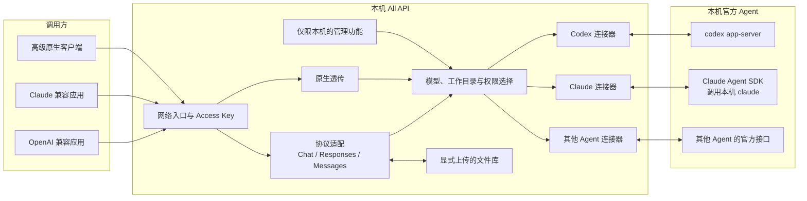
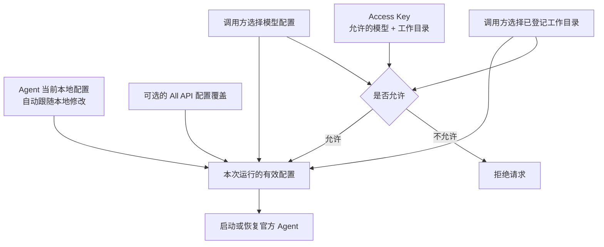
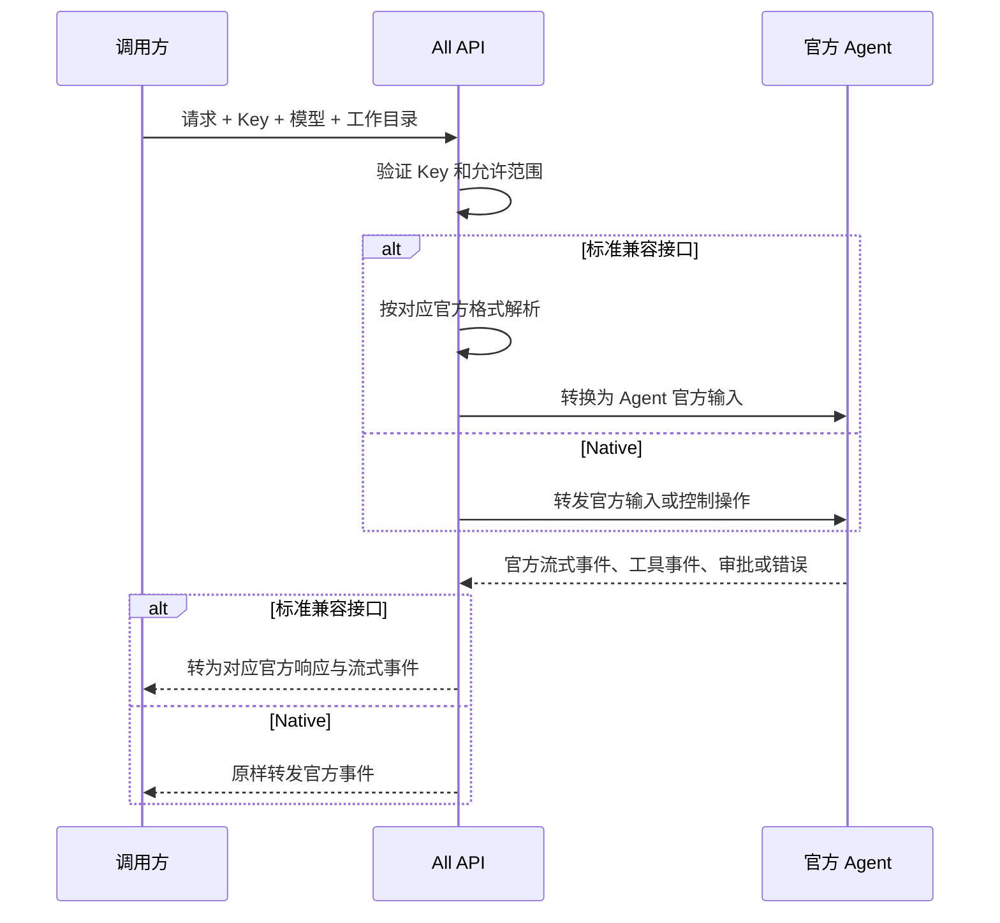
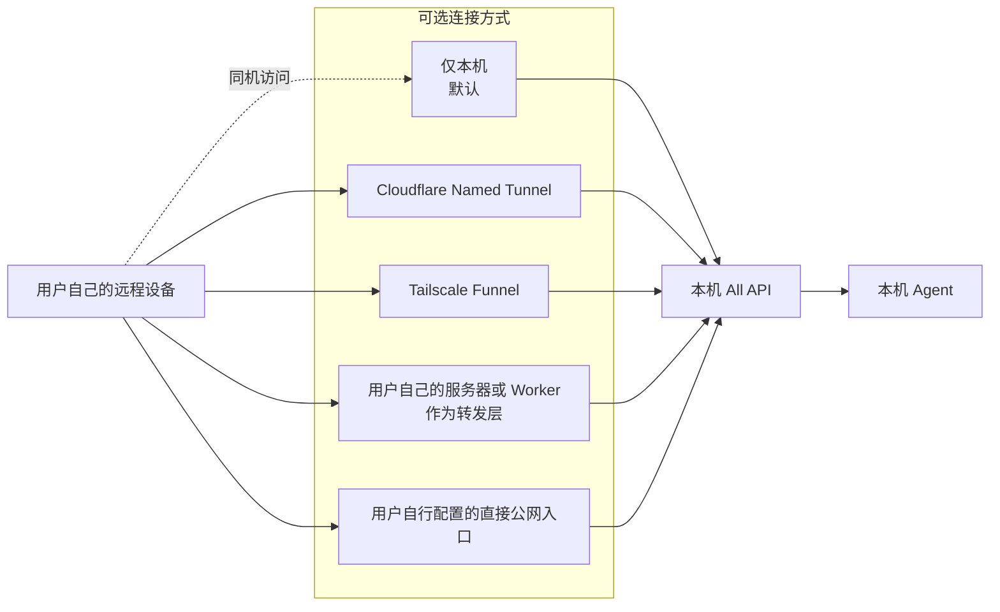

# All API 完整方案决策图

状态：目标方案已实现；本文同时作为架构约束和验收依据。

本文描述当前主线方案。旧的极简接口和配置格式不再兼容。

核心原则：

> All API 不重新发明 Agent。它只组合本机 Agent 的官方能力，提供常用 API 兼容层，并保留最完整的原生连接。

## #1：All API 的产品边界是什么？

Blocked by: 无  
Type: Discuss

### Question

All API 是模型网关、Agent 平台，还是多机调度中心？

### Answer

All API 是一个运行在用户本机的 Agent 桥接器：

- All API 与被调用的 Agent 永远运行在同一台机器。
- 它把本机 Codex、Claude 等 Agent 暴露成常见 API。
- 它不建设公共中继服务，也不统一管理多台电脑。
- 需要聚合多台电脑的用户，可以在 All API 外部自行建设转发层。
- All API 不复制 Agent 的工具、会话、权限系统和配置系统。

## #2：对外提供哪些使用方式？

Blocked by: #1  
Type: Discuss

### Question

应该只提供一种自创协议，还是兼容现有生态？

### Answer

同时提供四种入口：

1. OpenAI Chat Completions：兼容大量现有应用。
2. OpenAI Responses：作为 OpenAI 生态的完整新接口。
3. Anthropic Messages：兼容 Claude 原生生态。
4. Native：给高级客户端使用，保留 Agent 官方消息和全部能力。

不提供已经过时的文本 Completions 接口。

调用哪种接口，就严格使用哪家的官方输入、输出、流式事件和错误格式。标准接口中不加入 All API 私有字段。

如果某项参数或能力不能准确实现，则明确失败；不能静默忽略，也不能假装成功。

## #3：整体架构如何分层？

Blocked by: #1, #2  
Type: Discuss

### Question

怎样既保持简单，又能兼容多种协议和多个 Agent？

### Answer

All API 只维护两类必要逻辑：

- 外部标准协议与 Agent 官方协议之间的转换。
- Access Key、工作目录和本机管理等桥接层职责。

Agent 已经提供的能力不在 All API 中重新实现。

## #4：如何连接 Codex、Claude 和未来 Agent？

Blocked by: #3  
Type: Research

### Question

应该控制终端界面，还是使用官方程序接口？

### Answer

- Codex 使用用户当前安装的 `codex app-server`。
- Claude 使用官方 Claude Agent SDK，并指定用户当前安装的 `claude` 程序。
- SDK 不另设隔离配置，默认读取用户、项目和本地 Claude 配置。
- 未来 Agent 按以下优先级接入：
  1. 官方应用服务器或机器协议。
  2. 官方 Agent SDK。
  3. 官方结构化 CLI 输入输出。
  4. 没有机器接口时才考虑受限连接，并明确缺失能力。

不通过模拟键盘、解析彩色终端界面或猜测提示文字实现正式连接。

Native 模式只增加最薄的传输外壳。Agent 的官方事件内容保持不变，控制操作与官方操作一一对应。

## #5：模型、Agent 配置与工作目录是什么关系？

Blocked by: #3, #4  
Type: Discuss

### Question

如何允许配置，又避免为每种组合创建大量名称？

### Answer

模型名称代表一个可调用的 Agent 配置，例如：

- `codex`
- `codex:review`
- `claude`
- `claude:plan`

默认配置不复制 Agent 的本地配置，而是在每次启动时直接使用本机当前配置。

用户可以额外创建 All API 管理的配置；它只保存对本地配置的覆盖项，例如模型、权限模式、工作目录或 Agent 原生配置。覆盖项仍使用各 Agent 自己的字段，不创造统一的万能 Agent 配置语言。

工作目录单独登记：

- 调用方可以查询当前 Key 允许使用的工作目录。
- 调用时选择工作目录的名称或 ID。
- 公网调用方不能提交任意本机绝对路径。
- Access Key 分别限制可用模型和可用工作目录。

## #6：一次请求怎样执行？

Blocked by: #2, #3, #5  
Type: Discuss

### Question

兼容接口和原生接口如何共用同一个 Agent？

### Answer

客户端断开连接不会自动取消 Agent。Agent 继续完成任务，只有明确的取消操作才停止。

## #7：会话由谁保存？

Blocked by: #4, #6  
Type: Discuss

### Question

All API 是否需要再保存完整对话历史？

### Answer

不需要。Agent 的会话历史是唯一事实来源：

- Chat Completions 和 Anthropic Messages 按官方方式由调用方携带历史。
- Responses 可通过上一条 Response 的标识继续。
- Native 直接使用 Agent 的原生会话。
- All API 只保存必要的标识映射和运行元数据，不复制完整对话。
- All API 返回的会话或 Response 标识可以是密封的、不透明引用，用来定位 Agent 会话。

## #8：工具、审批和执行中输入如何处理？

Blocked by: #2, #4, #6  
Type: Discuss

### Question

不同 Agent 的工具与交互方式不同，All API 是否需要统一它们？

### Answer

不统一，只按来源处理：

- Agent 自带工具由 Agent 自己执行。
- 调用方声明的函数工具按相应官方 API 返回给调用方执行。
- 无法准确对应的工具类型直接失败。
- 权限模式属于 Agent 配置，All API 只传给 Agent。
- Native 原样转发审批请求和审批结果。
- 标准接口无法表示交互审批时，不能伪造，必须失败或要求使用非交互权限配置。
- Codex 的引导、中断等能力直接映射到 `app-server` 官方操作。
- Claude 的执行中输入、取消和审批直接使用 Agent SDK 官方能力。
- All API 不实现自己的排队系统；需要排队的客户端自行保存消息，任务结束后再正常发送。

## #9：图片、文件和音频如何处理？

Blocked by: #2, #6  
Type: Research

### Question

是否需要发明统一附件格式或自动转换文件？

### Answer

不发明。每个标准接口使用其官方多模态格式：

- Responses 使用其原生图片和文件输入。
- Chat Completions 使用其原生图片、音频等内容块。
- Anthropic Messages 使用原生图片与文档内容块。
- Native 使用 Agent 官方附件类型。

支持官方允许的 URL、Base64 和文件标识。为了支持文件标识，All API 提供本地文件库。

All API 不自动 OCR、不自动转录音频、不偷偷转换 DOCX、PDF 等格式。目标 Agent 不支持时明确失败。

远程 URL 获取必须限制协议、地址范围、重定向、大小和超时，避免访问本机或内网敏感地址。

## #10：如何对外暴露？

Blocked by: #1, #3  
Type: Research

### Question

没有服务器的用户如何安全地从公网访问本机 All API？

### Answer

支持四种运行方式：

- 仅本机是默认方式。
- Cloudflare Named Tunnel 和 Tailscale Funnel 可由 All API 帮助配置。
- 有服务器的用户可以把服务器当作 relay，而不必把 Agent 搬到服务器上。
- All API 不运营公共 relay。
- All API 不内建多机 Agent 聚合架构。

## #11：管理权限和 Access Key 如何设计？

Blocked by: #5, #10  
Type: Discuss

### Question

如何避免一个公网 Key 获得本机管理权限？

### Answer

管理与调用彻底分离：

- 管理功能只开放给本机进程，通过操作系统本地通信与用户权限保护。
- 不设置可以从公网使用的 Admin Key。
- 公网 Access Key 只能调用 Agent、查询自己允许的模型和工作目录。
- 默认可以一键生成 Key。
- 自定义 Key 可以选择允许的模型和已登记工作目录，但不能修改模型内部配置。
- 模型列表和工作目录列表都按当前 Key 过滤。
- Agent 的安装、更新、配置修改、Key 管理和公网连接设置只能在本机操作。

## #12：错误、能力和用量如何返回？

Blocked by: #2, #4, #6  
Type: Discuss

### Question

All API 是否应该统一错误和能力描述？

### Answer

- OpenAI 入口返回 OpenAI 官方错误格式。
- Anthropic 入口返回 Anthropic 官方错误格式。
- Native 原样转发 Agent 官方错误事件。
- Agent 的失败反馈就是输出；All API 不隐藏、不自动修复、不自动重跑。
- 标准模型列表保持对应官方格式。
- 另提供清晰的 All API 能力查询，供设置界面或高级客户端提前判断图片、文件、工具、审批等支持情况。
- 用量只采用 Agent 官方返回的真实数据；没有真实数据时标记为不可用，不能估算。
- 每个请求生成追踪标识，但默认日志不记录请求正文。

## #13：并发、断线与服务生命周期如何处理？

Blocked by: #6, #7  
Type: Discuss

### Question

如何保护本机，又不重新实现任务调度系统？

### Answer

- 不同会话可以并行。
- 设置可调整的全局并发上限。
- 达到上限时返回繁忙，不由 All API 排队。
- 同一会话的并发行为完全服从 Agent 官方规则。
- 客户端断线后任务继续，明确取消才停止。
- 电脑休眠时遵循操作系统和 Agent 的自然行为。
- All API 或 Agent 崩溃后，正在执行的任务标记为中断，不自动重跑。
- 已保存会话仍由 Agent 自己恢复。
- 开机或登录自动启动是用户可以打开或关闭的功能，不强制开启。

## #14：Agent 如何安装与更新？

Blocked by: #4, #11, #13  
Type: Discuss

### Question

All API 是否只检测 Agent，还是也帮助安装和更新？

### Answer

All API 的本地管理功能提供：

- 检测 Agent 是否安装及当前版本。
- 一键下载安装。
- 检查并执行更新。
- 可选自动更新。

安装和更新只调用 Agent 官方发布渠道、安装器和更新机制；All API 不重新托管或修改 Agent。

更新在本机确认后执行，并避开正在运行的任务。Agent 的登录和凭据仍由 Agent 自己管理。

## #15：隐私和本地存储原则是什么？

Blocked by: #7, #9, #11  
Type: Discuss

### Question

All API 默认保存哪些内容？

### Answer

默认只保存运行所需的最少信息：

- Access Key 的哈希，不保存可恢复的明文 Key。
- 模型配置覆盖、已登记工作目录和权限关系。
- 会话定位所需的不透明映射。
- 时间、状态、耗时、真实用量和错误类别等元数据。

默认不保存提示词、回复正文、完整终端输出或 Agent 对话副本。

用户通过文件接口明确上传的文件会保存在本机文件库中，直到用户删除或其明确设置的有效期结束。

调试日志必须由用户临时开启，并明确提示可能包含敏感内容。

## #16：如何增加新的 Agent？

Blocked by: #3, #4, #12  
Type: Discuss

### Question

新增 Agent 是否需要修改 All API 核心？

### Answer

Agent 连接器采用本地插件形式：

- 插件是独立本地进程。
- 插件声明 Agent 身份、版本、官方能力和支持的操作。
- 核心只负责启动、认证、路由和协议转换。
- 插件与 Agent 使用其官方程序接口。
- 插件协议公开，第三方可以增加 Agent。
- 插件只在本机运行，不成为远程管理插件。

核心不提前抽象尚不存在的通用 Agent 功能。只有多个官方 Agent 都确实需要的桥接概念，才进入核心。

## #17：明确不做什么？

Blocked by: 全部  
Type: Discuss

### Question

哪些功能虽然看起来强大，但不属于 All API？

### Answer

- 不运营公共 Agent relay。
- 不内建跨多台电脑的统一 Agent 调度。
- 不创造一套取代 Codex、Claude 的权限或配置语言。
- 不复制 Agent 会话历史。
- 不模拟终端 UI。
- 不静默忽略无法支持的请求字段。
- 不自动执行有损的附件转换。
- 不估算伪造用量。
- 不自动恢复或重跑失败任务。
- 不允许公网 Access Key 修改本机管理配置。

## #18：目标方案的验收标准是什么？

Blocked by: 全部  
Type: Discuss

### Question

什么时候可以认为完整方案已经实现？

### Answer

至少满足以下结果：

1. 常见 OpenAI 和 Anthropic 客户端只替换地址、Key 和模型名称即可调用。
2. Native 客户端能收到 Agent 官方的完整事件、审批和控制能力。
3. 无法无损表达的能力会明确失败，而不是丢失。
4. 默认直接继承本机 Agent 配置和会话。
5. Access Key 只能访问被授权的模型和已登记工作目录。
6. 本机、Cloudflare、Tailscale 和自有 relay 场景都能工作。
7. Codex、Claude 可以通过本地管理功能检测、安装和更新。
8. 新 Agent 可以通过本地连接器加入，而无需重写网络、安全和标准协议层。
9. 默认日志和存储不复制用户对话或文件内容。
