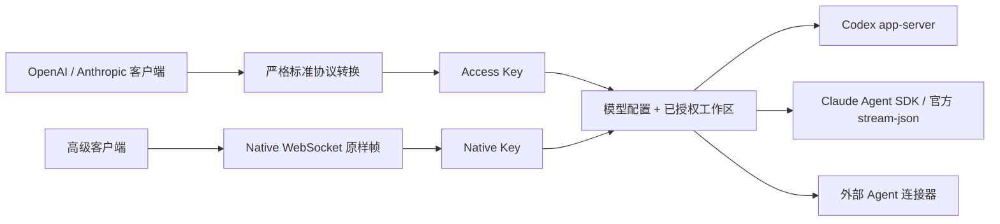

# All API

All API 是运行在 Agent 同一台机器上的桥接器。它把本机 Codex、Claude
以及外部连接器暴露成 OpenAI、Anthropic 和原生协议，同时保留 Agent 自己的
配置、权限、工具与会话。



完整产品决策和更多架构图见 [DECISION_MAP.md](./DECISION_MAP.md)。

## 安装与启动

要求 Node.js 20 或更新版本。Codex、Claude 可以预先安装，也可以稍后由
All API 调用官方安装渠道安装。

```sh
npm install -g @waibiwaibig/all-api
all-api init --workspace /absolute/path/to/project
all-api up
```

`init` 会检测本机 Agent，登记工作目录，并输出只显示一次的 Access Key。
服务默认只监听 `127.0.0.1:8787`。配置和 Key 哈希保存在 `~/.all-api`；
可用 `ALL_API_HOME` 改变该目录。0.3 使用配置版本 3，刻意不迁移旧配置。

```sh
all-api status
all-api down
all-api autostart on
```

`up` 后台运行，`serve` 前台运行。管理操作只通过本机 Unix socket（Windows
为 named pipe）执行，不存在公网 Admin Key。

## 客户端接口

| 用途 | 接口 | 输入输出 |
|---|---|---|
| OpenAI 旧生态 | `POST /v1/chat/completions` | Chat Completions |
| OpenAI 新生态 | `POST /v1/responses` | Responses |
| Anthropic 生态 | `POST /v1/messages` | Messages |
| 完整 Agent 能力 | `WS /v1/native/sessions?model=…` | Agent 官方机器消息原样帧 |
| 模型发现 | `GET /v1/models` | 按请求头返回 OpenAI 或 Anthropic 形状 |
| 文件 | `/v1/files` | 按请求头返回 OpenAI 或 Anthropic 形状 |
| 能力与工作区 | `GET /allapi/v1/catalog` | All API 能力目录 |

标准协议是严格兼容层：未知参数和无法准确实现的能力会明确失败，不会被静默
忽略。调用方函数工具只会在目标 Agent 适配器确实支持完整工具回合时开放；
交互审批只在 Native 中开放。强制 `tool_choice`、禁止并行工具等无法保证的
约束会失败。Anthropic 必填的 `max_tokens` 会被接收以保持客户端可调用，但
Coding Agent 没有对应的输出 token 上限；能力目录会明确返回
`max_tokens_enforced: false`。

Native 没有 All API 消息格式。WebSocket 建立后，客户端发给 All API 的每一个
帧就是发给 Agent 官方机器接口的帧；Agent 返回的帧也不加信封。例如 Codex
客户端直接发送：

```json
{"id":"1","method":"initialize","params":{"clientInfo":{"name":"my-client","version":"1.0"}}}
```

Codex Native 对应 `app-server` JSON-RPC；Claude Native 对应 Claude Code
官方双向 `stream-json`（也是 Agent SDK 使用的机器协议）。
`model` 只选择要启动的 Agent 配置；官方消息里能设置的模型、权限、目录或
会话信息仍以该消息为准。Native 传输错误在升级前使用 HTTP 状态，升级后使用
WebSocket close code，不会伪造一条 Agent 错误消息。

非浏览器客户端用 `Authorization: Bearer <Native Key>`。浏览器无法设置该
请求头时，用 `["allapi.native", "<Native Key>"]` 作为 WebSocket
subprotocol；Key 绝不放在 URL 查询参数中。

OpenAI 示例：

```sh
curl http://127.0.0.1:8787/v1/responses \
  -H "Authorization: Bearer allapi_..." \
  -H "Content-Type: application/json" \
  -H "X-AllAPI-Workspace: default" \
  -d '{"model":"codex","input":"检查当前项目并给出摘要"}'
```

Anthropic 示例：

```sh
curl http://127.0.0.1:8787/v1/messages \
  -H "X-Api-Key: allapi_..." \
  -H "Anthropic-Version: 2023-06-01" \
  -H "Content-Type: application/json" \
  -H "X-AllAPI-Workspace: default" \
  -d '{"model":"claude","max_tokens":1024,"messages":[{"role":"user","content":"检查项目"}]}'
```

每个 Access Key 都有一个默认工作区，因此通常可省略
`X-AllAPI-Workspace`；需要时可在该 Key 已授权的工作区内覆盖。调用方永远
不能直接传任意本地路径。

## 模型配置、工作区和 Key

模型名是 Agent 配置单，不是独立的大模型名称。`source=local` 每次运行直接
继承本机 Agent 的实时配置；`source=managed` 只保存要覆盖的原生参数。

```sh
all-api workspace add work /absolute/path/to/project

all-api model put codex:review \
  --agent codex \
  --workspace work \
  --source managed \
  --overrides '{"model":"gpt-5.4","approvalPolicy":"never","sandbox":"read-only"}'

all-api key create phone \
  --type access \
  --models codex:review \
  --workspaces work \
  --default-workspace work

# Native Key 不包含模型、配置或工作区授权；它只用于完整原生连接
all-api key create native-phone --type native
all-api models
all-api workspaces
all-api keys
```

修改模型配置和创建 Key 是两套接口。Access Key 只选择可用模型、工作区和
其中一个默认工作区，不携带模型内部参数。Native Key 是独立的高权限凭据，
能连接本机所有 Native Agent；撤销后，正在使用它的 WebSocket 会立即关闭。
两类 Key 都不能调用本机管理接口。删除仍被配置或 Access Key 使用的模型或
工作区会失败。

本机 Agent 配置会在 Agent 下次启动或恢复时自然生效；All API 模型配置的
修改也只影响之后的新请求或新 Native 连接，不改写已经运行的连接。

## Agent 管理

```sh
all-api agent detect
all-api agent install codex
all-api agent install claude
all-api agent update codex
all-api agent update claude
```

- Codex 使用官方 `codex app-server --stdio`，不解析 TUI。
- Claude 使用官方 Agent SDK，并显式连接 PATH 中的本机 `claude`。
- 安装使用官方 npm 包；Claude 更新会优先调用官方 `claude update`。
- Agent 登录仍由 Agent 自己完成，All API 不保存登录凭据。

外部连接器通过本地 JSON-lines RPC 加入：实现 `initialize`、`session/start`，
并用 `session/event` 通知返回标准内部事件；Native 则原样交换连接器消息。

```sh
all-api connector put my-agent \
  --command /absolute/path/to/connector \
  --args '[]' \
  --capabilities '{"input":["text"],"tools":[],"approvals":false,"continuation":true,"native":true,"usage":false}'
all-api model put my-agent --agent my-agent --workspace default
```

新增或替换连接器后重启服务，使 Agent 注册表重新加载。

## 暴露到公网

三种方式都仍由本机 All API 调用本机 Agent；All API 不运营公共 relay。

```sh
# Cloudflare Named Tunnel（首次会打开官方登录）
all-api expose cloudflare setup --hostname api.example.com
all-api expose cloudflare start

# Tailscale Funnel
all-api expose tailscale start

# 用户自己的 SSH relay
all-api expose relay start --host user@example.com --remote-port 8787
```

也可用 `all-api expose direct on` 改为监听所有网卡；该模式需要自行配置 TLS、
防火墙和端口转发，修改后需重启服务。Cloudflare 和 Tailscale 继续使用各自
官方客户端的免费额度、账户规则和访问控制。

## 会话、隐私与失败语义

- Chat Completions 和 Messages 是无状态转换；Responses 用不透明映射续接
  Agent 会话；Native 直接使用 Agent 会话。
- Agent 是对话历史的唯一事实来源。All API 只保存 Response ID、Agent 会话
  ID、状态、模型、工作区和官方 usage，不保存提示词或回复正文。
- Responses 的 `store:false` 不保存这条映射，因此之后不能查询或作为
  `previous_response_id` 使用。
- 明确上传的 Files 保存在本机、按 Key 隔离，直到调用者删除。
- HTTP 或 Native 客户端断线不会取消 Agent；只有 Responses cancel 或
  Native 的官方中断操作会取消。All API 不保存 Native 事件用于重放。
- 服务崩溃时，进行中的 Response 标记为 `interrupted`，不会自动重放。
- usage 只在 Agent 返回真实数据时出现，不估算、不填零。
- 标准 API 达到并发上限时立即返回 busy；Native 只限制连接数、单帧大小和
  待发送字节，不解析回合，也不建立 All API 自己的排队系统。
- 默认不记录请求正文；仅在主动设置 `ALL_API_DEBUG=1` 时输出详细内部错误。

## 开发

```sh
npm install
npm run check
npm test
```

测试覆盖严格协议、Key/工作区隔离、两种错误方言、Files、Responses 续接、
Native 原样事件、官方 Agent 接缝、本地管理 socket、断线与显式取消。
